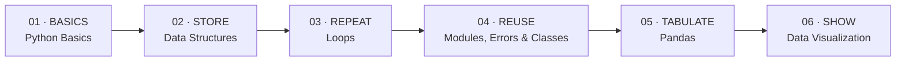

# Lesson 1 · Python: first steps

**From your first variable to your first chart.** Part of [The AI Learning Hub](https://github.com/the-ai-learning-hub).

📖 **[Open the Lesson 1 slides](https://the-ai-learning-hub.github.io/01-python-as-ai-first-steps/)**. Use ← → to move between slides.

This lesson teaches the Python that every AI and data project is built on. It is for anyone learning Python: no programming or technical background is needed, only [Lesson 0](https://github.com/the-ai-learning-hub/00-environment-setup) (uv, VS Code and your first program).

It has two parts: **the slides** explain each idea with one clear example, and **six notebooks** (in Portuguese 🇵🇹) let you run every example and practise with exercises that have hidden solutions.

---

## Why learn the basics if AI can write code?

An AI agent writes code fast and always sounds sure, but that code runs on **your** computer, with **your** files and **your** data. One wrong line can delete a database, overwrite yesterday's spreadsheet, loop all night calling a paid service, or quietly give a wrong answer that looks right.

You don't need to write every line yourself. You need to **understand every line you run**. The lesson opens with this ([slides 2–4](https://the-ai-learning-hub.github.io/01-python-as-ai-first-steps/#why)) and a checklist to use before approving any code:

| Before you press Enter, ask… | You learn it in |
|---|---|
| What does it do? | 01 · Basics |
| What data does it touch? | 02 · Data Structures · 05 · Pandas |
| Can it delete or overwrite? | 06 · Data Visualization (files) |
| How long will it run? | 03 · Loops |
| What happens if it fails? | 04 · Modules, Errors & Classes |

---

## The journey: six moves

Each module answers the question the previous one leaves open.



| # | Module | The question | Slides | Notebook | Exercises | 📚 Read more |
|---|---|---|---|---|---|---|
| 01 | **Basics** | How do I tell Python what to do? | [7–12](https://the-ai-learning-hub.github.io/01-python-as-ai-first-steps/#basics) | [01_Python_Basics](notebooks/01_Python_Basics/01_Python_Basics.ipynb) | 24 | [W3Schools](https://www.w3schools.com/python/python_variables.asp) |
| 02 | **Store** | How is data stored in Python? | [13–19](https://the-ai-learning-hub.github.io/01-python-as-ai-first-steps/#data-structures) | [02_Data_Structures](notebooks/02_Data_Structures/02_Data_Structures.ipynb) | 17 | [W3Schools](https://www.w3schools.com/python/python_lists.asp) |
| 03 | **Repeat** | How do we automate repetition? | [20–24](https://the-ai-learning-hub.github.io/01-python-as-ai-first-steps/#loops) | [03_Loops](notebooks/03_Loops/03_Loops.ipynb) | 17 | [W3Schools](https://www.w3schools.com/python/python_for_loops.asp) |
| 04 | **Reuse** | How do we reuse and protect code? | [25–28](https://the-ai-learning-hub.github.io/01-python-as-ai-first-steps/#reuse) | [04_Modules_Errors_Classes](notebooks/04_Modules_Errors_Classes/04_Modules_Errors_Classes.ipynb) | 13 | [W3Schools](https://www.w3schools.com/python/python_classes.asp) |
| 05 | **Tabulate** | How do we work with tables at scale? | [29–34](https://the-ai-learning-hub.github.io/01-python-as-ai-first-steps/#pandas) | [05_Pandas](notebooks/05_Pandas/05_Pandas.ipynb) | 24 | [W3Schools](https://www.w3schools.com/python/pandas/default.asp) |
| 06 | **Show** | How do we make the result obvious? | [35–38](https://the-ai-learning-hub.github.io/01-python-as-ai-first-steps/#visualization) | [06_Data_Visualization](notebooks/06_Data_Visualization/06_Data_Visualization.ipynb) | 14 | [W3Schools](https://www.w3schools.com/python/matplotlib_intro.asp) |

Slide 1 is the cover, 2–4 explain why the basics matter, 5–6 show the journey, 39–40 wrap up, 41 is a **glossary of 12 words in plain English**, and 42–44 are reference cheat sheets.

---

## What you will be able to do

**01 · Basics**: create variables and convert between types (`int`, `float`, `str`, `bool`, `None`); use arithmetic, comparison and logical operators; write functions with parameters, defaults and `return`; slice and format strings with f-strings; make decisions with `if` / `elif` / `else` and `match`.

**02 · Store**: choose between `list`, `tuple`, `set` and `dict` based on order, mutability, duplicates and lookups; avoid off-by-one errors with zero-based indexing; read nested data like an API or LLM reply (JSON).

**03 · Repeat**: choose `while` (unknown count) or `for` (known sequence); use `range`, `enumerate`, `zip`, `break` and `continue`; write list and dict comprehensions; avoid infinite loops; build the classic Hangman game step by step.

**04 · Reuse**: import the standard library (`math`, `random`, `datetime`, `json`, `collections`…) and third-party libraries (`uv add`); write your own module; read a traceback and handle errors with `try` / `except` / `raise`; write classes with attributes, methods, inheritance and `@dataclass`.

**05 · Tabulate**: learn pandas as a penguin researcher in Antarctica (**Palmer Penguins**): build a `Series` and a `DataFrame`, load a CSV, inspect it in five minutes, select with `loc` / `iloc`, filter, clean missing values and duplicates, add columns, `groupby` and summarize. Then investigate the **Titanic** on your own: who survived, and why? An optional extra challenge uses real, messy data (a catalogue of 1,006 classic books).

**06 · Show**: read and write text files safely; count words and remove stop words; draw bar, line, pie, scatter, histogram, box and violin plots with Matplotlib and Seaborn; then **import your own chart module** (`graficos.py`) to make publication-quality charts in one line, and analyse the novel *Dom Casmurro*.

### Publication-quality charts with `graficos.py`

Notebook 06 comes with [`graficos.py`](notebooks/06_Data_Visualization/graficos.py), a small module that you import into the notebook (which also practises the imports from module 04):

```python
from graficos import aplicar_tema, barras, dispersao, histograma, caixa, guardar

aplicar_tema()
fig, ax = barras(sobrevivencia, titulo="97% das mulheres da 1.ª classe sobreviveram",
                 destaque=["1.ª classe · mulher"])
guardar(fig, "titanic_sobrevivencia")
```

Every function (`barras`, `linha`, `histograma`, `dispersao`, `caixa`, `donut`, `mapa_calor`, `nuvem_palavras`) gives a sorted, labelled, accessible chart with a title that states the conclusion, a colour-blind-safe palette, the Inter typeface and Portuguese number formatting. The last exercise asks you to add your own function to the module.

---

## How to start

You need what you installed in [Lesson 0](https://github.com/the-ai-learning-hub/00-environment-setup): **uv**, **VS Code** (with the Python and Jupyter extensions) and **Git**.

```bash
git clone https://github.com/the-ai-learning-hub/01-python-as-ai-first-steps.git
cd 01-python-as-ai-first-steps
uv sync
code .
```

`uv sync` installs Python 3.12 and every library this lesson uses (pandas, matplotlib, seaborn, requests, wordcloud) into a local `.venv`.

In VS Code, open a notebook in `notebooks/`, click **Select Kernel** (top right) → **Python Environments** → **.venv**, then run each cell with `Shift` + `Enter`, in order.

> **No installation?** Every notebook has an **Open in Colab** button at the top. It runs in your browser and downloads the data (and `graficos.py`) it needs.

### How the notebooks work

Every notebook follows the same structure, so you always know where to look:

1. **🎯 Learning goals**, duration and prerequisites, then a clickable **index**.
2. **Sections**: a short explanation → an example you run → tips (💡), common mistakes (⚠️) and links to AI (🤖).
3. **📚 Read more**: each section ends with a link to the matching [W3Schools](https://www.w3schools.com/python/) page, for a second explanation and try-it-yourself examples.
4. **✏️ Exercises** marked ⭐ (easy) to ⭐⭐⭐ (challenge), **109 in total**. Each one has a starter cell that already runs and a **💡 Ver solução** block. Try first, then compare.
5. **🏋️ Practise more** and a **📌 Summary**: a one-table cheat sheet of the notebook.
6. **Footer** with links to the previous and next notebook.

---

## Repository layout

```
01-python-as-ai-first-steps/
├── index.html                      ← the slides (served by GitHub Pages)
├── assets/slides/                  ← cheat-sheet images used by the slides
├── notebooks/
│   ├── 01_Python_Basics/
│   ├── 02_Data_Structures/
│   ├── 03_Loops/
│   ├── 04_Modules_Errors_Classes/
│   │   └── utilidades.py           ← an example module you import
│   ├── 05_Pandas/
│   │   └── data/                   ← penguins.csv · titanic.csv · classics.csv (extra challenge)
│   └── 06_Data_Visualization/
│       ├── graficos.py             ← chart module you import
│       ├── fonts/                  ← Inter typeface (SIL Open Font License)
│       └── data/                   ← penguins.csv · titanic.csv · text.txt · dom_casmurro.txt
├── tools/
│   ├── run_notebooks.py            ← runs every notebook end to end
│   └── audit_notebooks.py          ← checks structure, links and leftovers
├── pyproject.toml · uv.lock        ← the lesson's dependencies
└── .nojekyll · LICENSE · README.md
```

Each notebook folder is self-contained, so it also works on its own in Colab. Files the notebooks write (exercise outputs, saved charts) go to an `output/` folder inside each notebook folder, which Git ignores. The files in `data/` are never modified.

---

## The slides

Open [the web slides](https://the-ai-learning-hub.github.io/01-python-as-ai-first-steps/), or open `index.html` in any browser. No build step or server is needed.

| Key | Action |
|---|---|
| `→` `Space` `Enter` / `←` `Backspace` | Next / previous slide |
| `Home` / `End` | First / last slide |
| `N` | Toggle speaker notes |
| `F` | Fullscreen |

Every slide has its own link: by number (`#7`) or, for the start of each part, by name: [`#why`](https://the-ai-learning-hub.github.io/01-python-as-ai-first-steps/#why), [`#journey`](https://the-ai-learning-hub.github.io/01-python-as-ai-first-steps/#journey), [`#basics`](https://the-ai-learning-hub.github.io/01-python-as-ai-first-steps/#basics), [`#data-structures`](https://the-ai-learning-hub.github.io/01-python-as-ai-first-steps/#data-structures), [`#loops`](https://the-ai-learning-hub.github.io/01-python-as-ai-first-steps/#loops), [`#reuse`](https://the-ai-learning-hub.github.io/01-python-as-ai-first-steps/#reuse), [`#pandas`](https://the-ai-learning-hub.github.io/01-python-as-ai-first-steps/#pandas), [`#visualization`](https://the-ai-learning-hub.github.io/01-python-as-ai-first-steps/#visualization) and [`#glossary`](https://the-ai-learning-hub.github.io/01-python-as-ai-first-steps/#glossary). Named links keep working when slides are added. **Print → Save as PDF** gives one slide per page.

Every content slide follows the same pattern: an action title, one plain-language idea, *why it matters for AI & data*, a code example with its output, and a **gotcha** with a common mistake. Section dividers show where you are in the journey and link to the module's notebook and W3Schools page. Slides and code examples are in English; the notebooks are in Portuguese.

---

## For maintainers

Run every notebook top to bottom and save the outputs (it fails on any unexpected error), then check structure, links and leftovers:

```bash
uv sync
uv run python tools/run_notebooks.py                       # all notebooks
uv run python tools/run_notebooks.py notebooks/03_Loops/03_Loops.ipynb
uv run python tools/audit_notebooks.py
```

Cells that raise an error on purpose (to teach it) carry the cell tag `raises-exception`. To add a library: `uv add <library>`. When you add slides, link to them from notebooks by name (`#pandas`), not by number.

**GitHub Pages**: *Settings → Pages → Deploy from a branch → `main` / `(root)`*. The slides are `index.html` at the root, and `.nojekyll` makes Pages serve the files as they are.

---

## Credits

- Content and examples: Diogo Freitas & João Francisco Botas.
- Further reading links: [W3Schools Python tutorial](https://www.w3schools.com/python/).
- Datasets:
  - [Palmer Penguins](https://allisonhorst.github.io/palmerpenguins/): Gorman, Williams & Fraser (2014), Palmer Station LTER (CC0), via the [seaborn-data](https://github.com/mwaskom/seaborn-data) repository.
  - Titanic passenger data, via [seaborn-data](https://github.com/mwaskom/seaborn-data).
  - [CORGIS Classics](https://corgis-edu.github.io/corgis/csv/classics/) (Project Gutenberg metadata).
  - *Dom Casmurro* by Machado de Assis (1899), from [Project Gutenberg](https://www.gutenberg.org/ebooks/55752) (public domain).
- Typeface: [Inter](https://rsms.me/inter/) by Rasmus Andersson, under the SIL Open Font License (see `notebooks/06_Data_Visualization/fonts/OFL.txt`).
- Visual theme of the slides adapted from a Slidesgo template.
- Appendix cheat sheets are third-party references and keep their original attribution: list methods by @akshay_pachaar; the pandas data-wrangling cheat sheet originally written by Irv Lustig, Princeton Consultants (pandas.pydata.org).

Licensed under the [MIT License](LICENSE).
