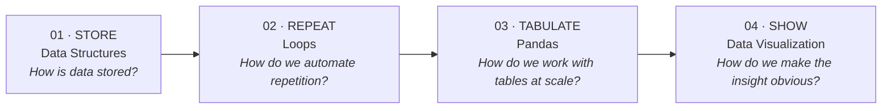

# 01 · Python as AI: First Steps

> **[AI for Tech Leaders]** — from raw variables to visual insights, in one continuous journey.

A single, unified slide deck that takes technology and product leaders from *how Python holds data* to *a chart a board can act on*. It is built for people who build, buy or approve AI and data work. The aim is not to make you a developer. It is to show you what the code does to your data, so you can validate a hypothesis quickly, evaluate an AI solution and challenge the evidence behind a decision.

| | |
|---|---|
| **Deck** | [`Python_as_AI_First_Steps.pptx`](./Python_as_AI_First_Steps.pptx) — 28 slides, 16:9 |
| **Web deck** | [`html/index.html`](./html/index.html) — the same 28 slides as a browser presentation, with all examples in English |
| **Audience** | Technology and product professionals, decision-makers |
| **Format** | Live session or self-paced pre-read (every slide carries speaker notes) |
| **Duration** | ~60–75 min live, incl. discussion |
| **Prerequisites** | None to follow along. To run the examples: [uv](https://docs.astral.sh/uv/). It installs Python 3.12 and every library for you |
| **Authors** | Diogo Freitas & João Francisco Botas |

---

## The journey: four moves

Each module answers the question the previous one leaves open.



| Move | Module | The question it answers | Bridge to the next module |
|---|---|---|---|
| **01 · Store** | Data Structures | How is data stored in Python? | *You can store data. Now make it work at scale.* |
| **02 · Repeat** | Loops | How do we automate repetition? | *Loops scale your logic. Tables scale your data.* |
| **03 · Tabulate** | Pandas | How do we work with tables at scale? | *Numbers in a table inform. A chart persuades.* |
| **04 · Show** | Data Visualization | How do we make the insight obvious? | *Next in the series: ML Models (classification and regression).* |

---

## Deck structure

| Slides | Section | Content |
|---|---|---|
| 1–3 | **Introduction** | Title · the four-move journey · why every AI product runs on these moves |
| 4–10 | **01 · Data Structures** | Divider · container comparison (list / tuple / set / dict) · zero-indexing and core concepts · `list` · `tuple` · `set` · `dict` |
| 11–14 | **02 · Loops** | Divider · why loops · `while` (conditional loop) · `for` (sequential loop over a range, a string and a list) |
| 15–19 | **03 · Pandas** | Divider · what Pandas is · `Series` vs `DataFrame` (the `tips` dataset) · reading data · six inspection commands |
| 20–23 | **04 · Data Visualization** | Divider · raw text and escape sequences · Matplotlib vs Seaborn · the same top-10 word-frequency data charted both ways |
| 24–25 | **Wrap-up** | What you can now do, and what to ask your team · thank you |
| 26–28 | **Appendix** | Reference cheat sheets: list & tuple methods · set & dict methods · Pandas data wrangling |

The deck is organized into PowerPoint **sections** that match this table, so each module can be presented on its own.

### Slide anatomy

Every content slide follows the same rhythm, so the audience always knows where to look:

1. **Action title**: the insight, not the topic (*"Sets: kill duplicates, compare groups instantly"*).
2. **Core concept**: one plain-language sentence explaining the mechanism.
3. **Why it matters for AI & data**: 1–2 bullets on practical impact.
4. **Code + output**: the original example, shown as live, syntax-highlighted text.
5. **Gotcha / Key takeaway**: one high-contrast callout with a real-world pitfall or best practice.

Section dividers show a **journey tracker** (where you are, what's done, what's next) and a one-paragraph narrative bridge. The editor-style tab bar at the top of every slide highlights the active module.

---

## Key learning outcomes

By the end of the session, participants can:

**01 · Store**
- Choose between `list`, `tuple`, `set` and `dict` based on order, mutability, duplicates and lookup needs.
- Recognize that API payloads and LLM responses (JSON) are dictionaries and lists.
- Avoid off-by-one errors by reasoning in zero-based indices.

**02 · Repeat**
- Tell when a task is a loop, and choose `while` (unknown count, condition-driven) or `for` (known sequence).
- Spot the classic failure modes: infinite loops, and `range()` stopping before its end value.

**03 · Tabulate**
- Explain the difference between a `Series` and a `DataFrame`, and why the DataFrame is the standard input for ML.
- Load CSV, Excel, SQL or JSON data in one line, and run a first-five-minutes inspection (`head`, `shape`, `columns`, `info`, `describe`, `sort_values`).

**04 · Show**
- Pick Seaborn for fast exploration and Matplotlib for fine-grained control.
- Judge whether a chart answers its question in seconds (sorted, labeled, cleaned of noise such as stop words).

**As a leader**, participants leave with four questions to ask any data or AI team:

> *Is this the right container for how we'll use the data?* · *Which manual, repeated step could a loop automate?* · *Did we check shape, types and missing values first?* · *Does the chart answer the question in two seconds?*

---

## Presenting the deck

- **Speaker notes** on every slide hold the talk track.
- **Code examples** keep their original logic, variable names and data exactly as written (e.g. `frutas`, `aluno`, `"Vou estudar Python!"`). Code comments are translated to English; comments that show a printed result (e.g. `# banana`) are unchanged.
- **Run the examples live** (optional). This folder is a member of the repository's uv workspace (see the root `README.md`). From the repository root, install exactly what this lesson needs:

  ```bash
  uv sync --package python-as-ai-first-steps
  ```

  Then open the notebooks in `Data_Structures/`, `Loops/`, `Pandas/` and `Data_Visualization/` with the `.venv` kernel. To add a library to this lesson, run `uv add --package python-as-ai-first-steps <library>`.

  Slide 17 loads Seaborn's built-in `tips` dataset (`sns.load_dataset('tips')`), so no local files are needed. Slide 19 reads `ficheiro_exemplo.csv`, which is a placeholder for any CSV of your own.

---

### The web deck (`html/`)

Open `html/index.html` in any modern browser. No build step or server is needed. Keep the `assets/` folder next to it, because it holds the appendix cheat sheets.

| Key | Action |
|---|---|
| `→` `Space` `Enter` / `←` `Backspace` | Next / previous slide |
| `Home` / `End` | First / last slide |
| `N` | Toggle speaker notes |
| `F` | Fullscreen |

Each slide has its own URL (`index.html#7`), and the browser's **Print → Save as PDF** gives one slide per page. In the web deck, the code examples are translated to English (e.g. `fruits`, `student`, `counter`), and the *Dom Casmurro* excerpt is shown in English translation. The word-frequency chart still counts the original Portuguese words, with their English meaning beside each one.

---

## Credits

- Content and examples: Diogo Freitas & João Francisco Botas.
- Visual theme adapted from a Slidesgo template.
- Appendix cheat sheets are third-party references and keep their original attribution: list methods by @akshay_pachaar; the Pandas data-wrangling cheat sheet originally written by Irv Lustig, Princeton Consultants (pandas.pydata.org).
